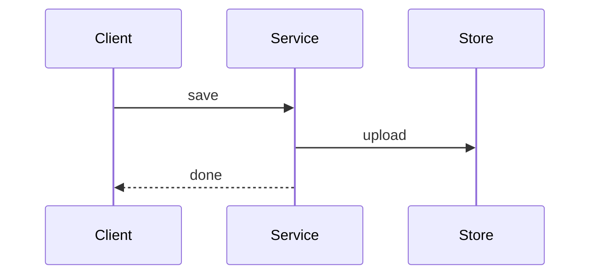
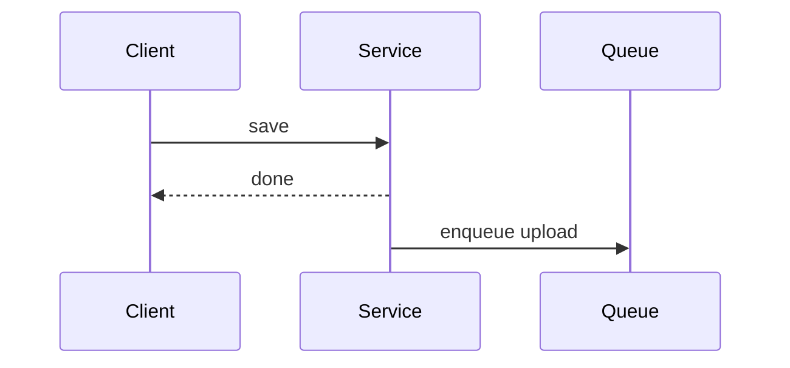

# The scratch page

A terminal session draws text only: a Mermaid block shows as its source, and an HTML artifact does not show at all. A visual of either kind that belongs in a conversation message goes on the task's **scratch page** instead. The user keeps that page open in the viewer beside the session, and it reloads on every change.

| Visual | Where it goes |
| --- | --- |
| Text shapes: call tree, file tree, component tree, pseudocode, signature, endpoint shape, `diff`, table | In the message |
| Mermaid diagram | Scratch page |
| HTML artifact: mockup, dense diagram | Scratch page, embedded |

Documents are unaffected. The viewer renders them, so Mermaid and embedded HTML inside a TDD, PRD, research document, outline or PR description stay exactly as their skill describes.

## Adding an entry

One command adds the entry at the top of the page, newest first, and prints the page's link:

````bash
keylight scratch <<'ENTRY'
## Q3: Where does the sync run?

### A: inline in the request



### B: background job after the commit


ENTRY
````

- **One entry per message**, holding every visual that message needs.
- **Head it with the question or topic**, worded as in the message.
- **Label options as the message does**: A, B, C.
- **Embed an HTML artifact** by writing its file to the folder `keylight scratch --dir` prints, then putting its `task-artifact` fence in the entry, as [`HTML-ARTIFACTS.md`](HTML-ARTIFACTS.md) describes.
- **Follow the Mermaid rules** in [`TASKS.md`](TASKS.md), so the diagram parses.

## In the message

Say in one line what each visual shows, and give the page's link once per message. The message still carries the options, their tradeoffs and your recommendation in words, so the decision reads without the page.

When a decision is resolved, its chosen visual goes into the document as usual. The scratch entry stays as the record of the options considered.
