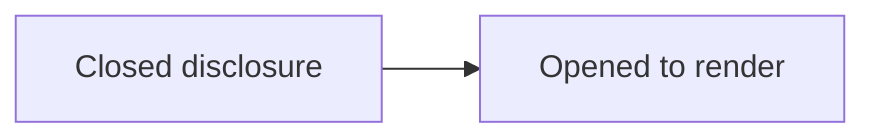

# Folded content

A diagram and an artifact inside closed panels of one accordion.

<details name="folded"><summary>Diagram</summary>



</details>

<details name="folded"><summary>Artifact</summary>

```task-artifact
embed.html
```

</details>
