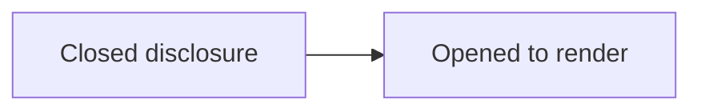

# Folded content

A diagram and an artifact inside closed disclosures.

<details><summary>Diagram</summary>



</details>

<details><summary>Artifact</summary>

```task-artifact
embed.html
```

</details>
